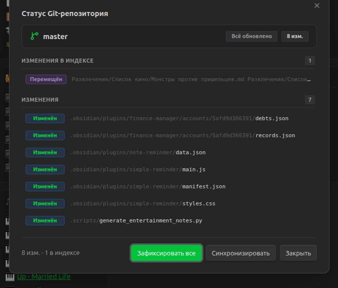
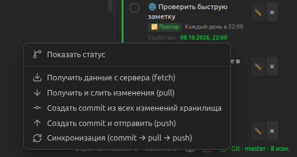
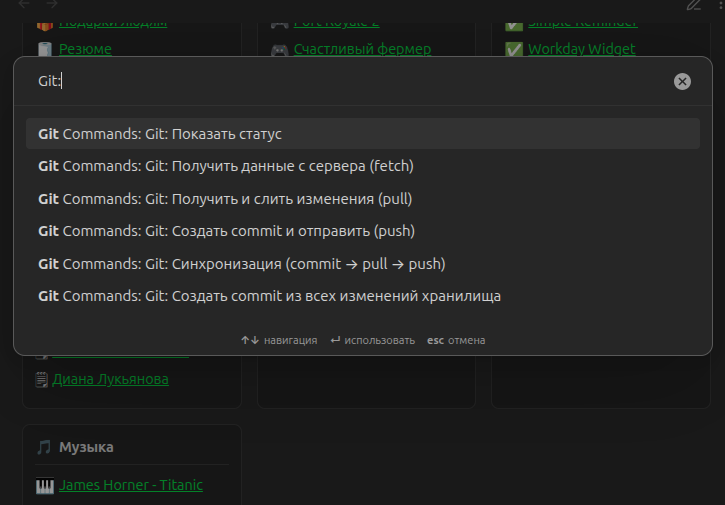
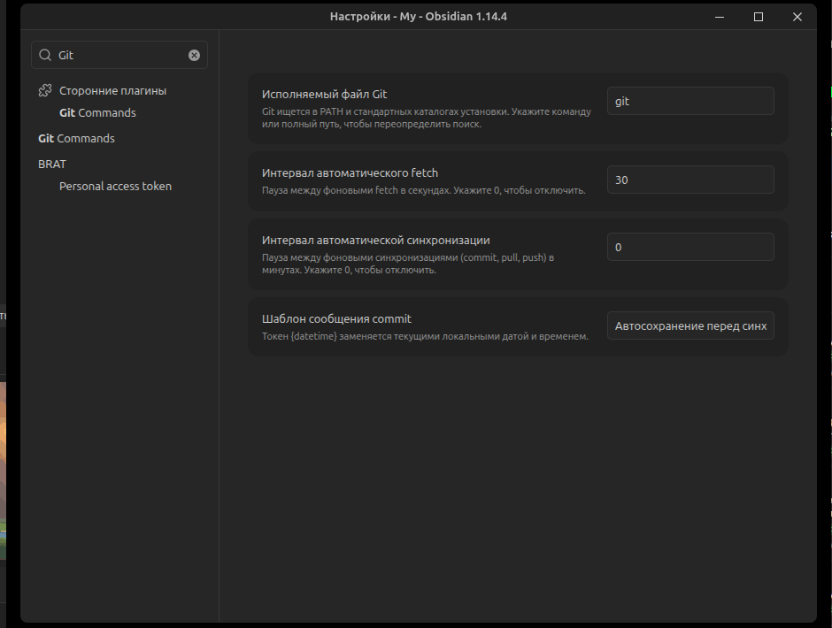

# Git Commands

[](https://github.com/dimanchello/obsidian-git/actions/workflows/ci.yml)
[](https://github.com/dimanchello/obsidian-git/releases)
[](LICENSE)

A clean, lightweight native Git integration plugin for [Obsidian](https://obsidian.md) Desktop.

The plugin delegates repository, index, merge, and transport operations directly to your system's installed Git executable. By avoiding bundled JavaScript/Wasm Git reimplementations, it ensures maximum performance, security, and native Git semantics.

Supported desktop platforms: Linux, Windows, and macOS.

---

## Features

- **Status Bar Indicator**: Real-time indicator in the Obsidian status bar displaying:
  - Active branch name (or detached `HEAD` state)
  - Working-tree change counts and merge conflict warning state
  - Commits ahead of or behind the remote tracking branch
  - Configurable click/keyboard action: quick actions menu or interactive status modal
  - Optional left ribbon shortcut icon
- **Command Palette Actions**:
  - `Show status`: Open an interactive modal to inspect staged, unstaged, untracked, and conflicted files, stage/unstage/discard changes, view diffs, and trigger quick actions
  - `Show commit history`: View recent repository commits with collapsible per-commit affected file lists
  - `Fetch from remote`: Fetch remote commits without altering the working tree
  - `Pull changes`: Pull remote changes using the configured pull strategy (`Merge`, `Rebase`, or `Fast-forward only`)
  - `Commit all vault changes`: Flush open editors, stage all vault changes, and create a commit
  - `Commit with custom message`: Flush open editors, stage all vault changes, and commit with a custom message entered in a modal
  - `Push committed changes` (`Push (commits only)`): Push existing local commits to upstream without staging or creating a commit
  - `Commit all changes and push` (`Commit & Push`): Flush open editors, stage and commit all vault changes, and push to upstream
  - `Sync: commit, pull, and push`: Flush open editors, commit all changes, pull remote commits, and push local changes
  - `Show last Git error`: View command line, exit code, timestamp, `stderr`, and `stdout` for the latest Git command error in this session
  - `Initialize Git repository`: Run `git init` inside a vault that is not yet a Git repository
  - `Abort current operation`: Cancel an in-progress Git command
- **Automation**:
  - Periodic background fetch (configurable interval in seconds; default `30`)
  - Configurable periodic auto-sync interval in minutes
  - Configurable debounced auto-backup after editing in minutes (commits and pushes after edits settle)
  - Optional auto-pull on startup
  - Configurable background sync and backup notification mode (`Errors only`, `All`, or `Silent`)
- **Customizable Commit Message**:
  - Commit message template support with `{datetime}` timestamp substitution (replaces all `{datetime}` occurrences)
- **Executable Discovery**:
  - Automatic lookup in system `PATH` and common platform-specific directories (`/usr/bin/git`, `/usr/local/bin/git`, Program Files, Homebrew, Xcode command-line tools)
  - Optional custom executable command or absolute path in settings, with an in-settings **Test Git** button
- **Internationalization (i18n)**:
  - Automatic language selection matching Obsidian (English and Russian supported, graceful fallback to English)
- **Safe Execution**:
  - Non-shell child process execution (`execFile`) with strict argument arrays to prevent shell injection
  - Terminal interactive prompts disabled (`GIT_TERMINAL_PROMPT=0`)
  - Configurable process timeouts (`5–3600` seconds; default `120`)

---

## Screenshots

### Repository Status Modal
Review changed files, staged and unstaged state, and perform one-click commit or sync operations.



### Status Bar & Quick Actions Menu
View branch and modified file indicators directly in the Obsidian status bar, and click to access the quick actions popup.



### Command Palette
Trigger all operations quickly via the standard Obsidian Command Palette.



### Plugin Settings
Configure custom Git executable paths, auto-fetch and auto-sync intervals, pull strategy, notifications, and commit message templates.



---

## Prerequisites

1. **Obsidian Desktop** v1.8.7 or newer.
2. **Git** installed on your operating system and accessible in `PATH` (or configured via plugin settings).
3. Your vault must be inside an initialized Git repository (`git init`), or initialized using the `Initialize Git repository` command.

---

## Installation

### Via BRAT (Beta Reviewer's Auto-update Tester)

1. Install the [BRAT](https://github.com/TfTHacker/obsidian42-brat) plugin from Obsidian Community Plugins.
2. Open BRAT settings and click **Add Beta plugin**.
3. Enter `dimanchello/obsidian-git`.
4. BRAT will automatically download the plugin and keep it updated.

### Manual Installation

1. Go to the [Releases](https://github.com/dimanchello/obsidian-git/releases) page and download the latest release files:
   - `main.js`
   - `manifest.json`
   - `styles.css`
2. Open your Obsidian vault folder and navigate to `.obsidian/plugins/`.
3. Create a new directory named `git-commands`.
4. Place `main.js`, `manifest.json`, and `styles.css` into that directory:
   ```
   <vault>/.obsidian/plugins/git-commands/
   ├── main.js
   ├── manifest.json
   └── styles.css
   ```
5. In Obsidian, go to **Settings > Community plugins**, click **Reload plugins**, and enable **Git Commands**.

---

## Settings

| Setting | Default | Description |
| --- | --- | --- |
| **Git executable** | `git` | Command or full path to override `PATH` and standard install directory discovery. Includes a **Test Git** button to verify execution and version. |
| **Automatic fetch interval** | `30` | Delay between background fetches in seconds (`0–86400`). Set to `0` to disable. |
| **Automatic sync interval** | `0` | Delay between background syncs (`commit`, `pull`, `push`) in minutes (`0–10080`). Set to `0` to disable. |
| **Auto-backup after editing** | `0` | Minutes to wait after the last file edit before committing and pushing (`0–1440`). Set to `0` to disable. |
| **Auto-pull on startup** | `false` | Automatically pull changes from the remote repository when Obsidian starts. |
| **Pull strategy** | `Merge (--no-rebase)` | How remote changes are integrated when pulling (`Merge`, `Rebase`, or `Fast-forward only`). |
| **Git command timeout** | `120` | Maximum time in seconds to wait for a Git command before aborting (`5–3600`). |
| **Background sync notifications** | `Errors only` | When automatic sync and backup show notices (`Errors only`, `All (success and errors)`, or `Silent`). |
| **Status bar click action** | `Open actions menu` | Action when clicking or activating the Git status bar indicator (`Open actions menu` or `Open repository status modal`). |
| **Show ribbon icon** | `false` | Add a Git shortcut icon to the left ribbon. |
| **Commit message template** | *(localized default)* | Commit message format. `{datetime}` is replaced with the local date and time (blank falls back to the localized default `Vault backup before sync: {datetime}`). |

---

## Development

### Prerequisites

- Node.js 22+
- npm 10+

### Setup

```bash
# Clone the repository
git clone https://github.com/dimanchello/obsidian-git.git
cd obsidian-git

# Install dependencies
npm ci
```

### Scripts

- `npm run dev` &mdash; Watches source files and compiles in development mode into `dist/`.
- `npm run build` &mdash; Typechecks and bundles the plugin into `dist/` for production.
- `npm run check` &mdash; Runs TypeScript typechecking and all unit and integration tests.
- `npm run test:unit` &mdash; Runs isolated unit tests.
- `npm run test:integration` &mdash; Runs integration tests against local Git repositories.
- `npm version <patch|minor|major>` &mdash; Updates version in `package.json`, `manifest.json`, and `versions.json`.

---

## Architecture

- [`src/main.ts`](src/main.ts) &mdash; Obsidian entry point, commands, status bar integration, background automation, and lifecycle management.
- [`src/plugin-constants.ts`](src/plugin-constants.ts) &mdash; Shared plugin-level action identifiers, DOM constants, and formatting tokens.
- [`src/settings.ts`](src/settings.ts) &mdash; Settings schema, defaults, validation bounds, and parser.
- [`src/settings-tab.ts`](src/settings-tab.ts) &mdash; Obsidian settings tab UI and declarative controls.
- [`src/status-modal.ts`](src/status-modal.ts) &mdash; Interactive repository status modal with file grouping, staging/unstaging, discard confirmation, and action triggers.
- [`src/git-modals.ts`](src/git-modals.ts) &mdash; Commit message prompt, diff viewer, commit history, error diagnostics, and confirmation modals.
- [`src/ui-helpers.ts`](src/ui-helpers.ts) &mdash; Shared modal button, icon, and keyboard activation helpers.
- [`src/git/process-runner.ts`](src/git/process-runner.ts) &mdash; Node.js `execFile` abstraction avoiding shell interpolation.
- [`src/git/git-cli.ts`](src/git/git-cli.ts) &mdash; Maps high-level operations to Git argument vectors.
- [`src/git/git-constants.ts`](src/git/git-constants.ts) &mdash; Git argument vectors, pull strategies, exit codes, and conflict markers.
- [`src/git/git-executable-locator.ts`](src/git/git-executable-locator.ts) &mdash; Searches `PATH` and platform directories, validates with `git --version`.
- [`src/git/git-service.ts`](src/git/git-service.ts) &mdash; Validates command exit codes and coordinates status, fetch, pull, commit, push, staging, diff, log, and init.
- [`src/git/status-parser.ts`](src/git/status-parser.ts) &mdash; Parses Git porcelain v2 format.
- [`src/i18n/`](src/i18n/) &mdash; Typed English and Russian translations.

---

## License

This project is open source and available under the [MIT License](LICENSE).
